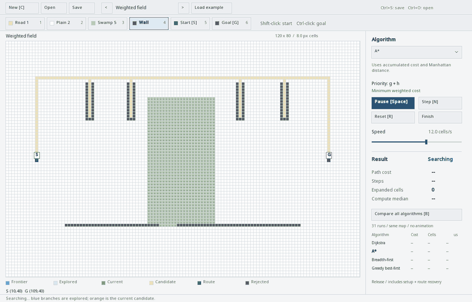
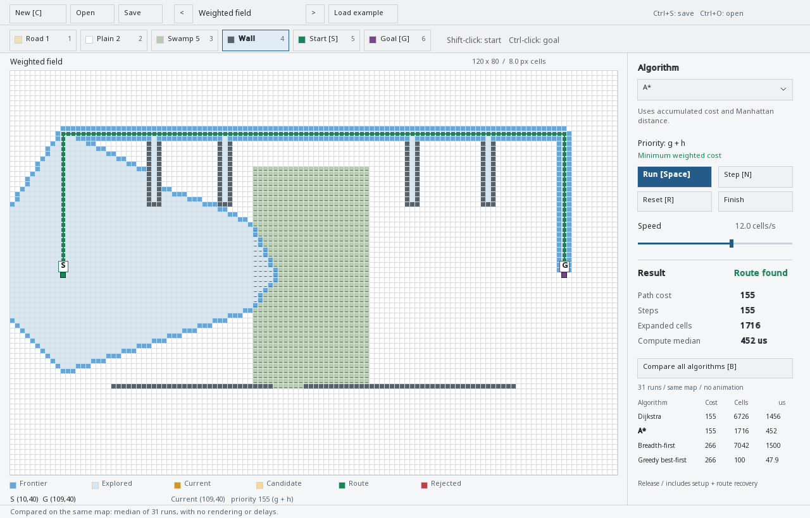
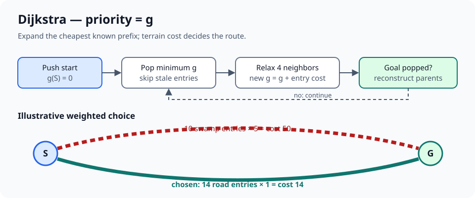
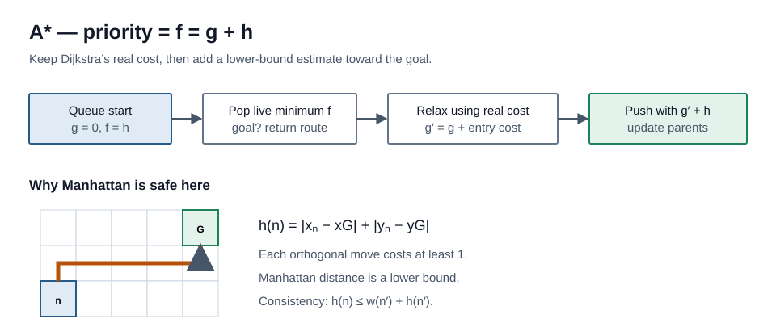
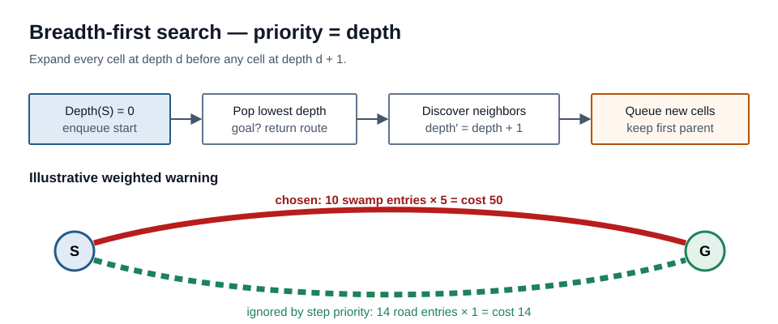
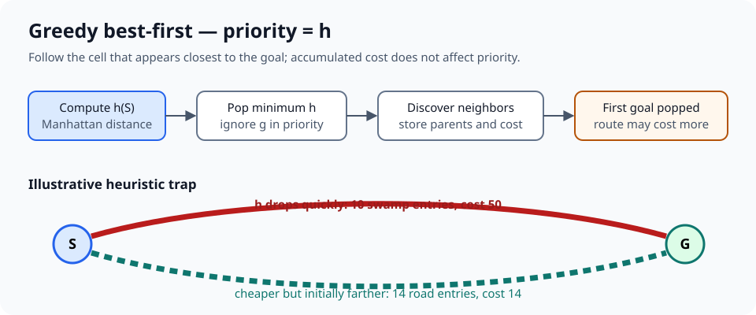

# PathExperiment

[English](README.md) · [Polski](README.pl.md) · [Українська](README.uk.md)



GIF przedstawia wybrane klatki dłuższego wyszukiwania. Tryb Step rozwija jedną komórkę naraz.



PathExperiment to aplikacja desktopowa w C++20 do rysowania ważonych map, obserwowania wyszukiwania krok po kroku i porównywania algorytmów w tych samych warunkach. Rdzeń wyszukiwania nie zależy od SFML, dlatego projekt jest zarówno narzędziem edukacyjnym, jak i prototypem przyszłej nawigacji jednostek w Ribterra.

[Strona najnowszego wydania](https://github.com/fipsyatina/PathExperiment/releases/latest) będzie zawierać gotowe pakiety, gdy wydanie zostanie opublikowane. Interfejs aplikacji jest angielski.

## Zaimplementowane funkcje

- [x] Domyślne pole 120 × 80 z komórkami około 8 px
- [x] Narzędzia: droga, teren zwykły, bagno, ściana, start i cel
- [x] Dowolne przechodnie komórki startu i celu
- [x] Dijkstra, A*, BFS i greedy best-first search
- [x] Wizualizacja komórek otwartych, zamkniętych i bieżących, odrzuconych sąsiadów, trasy tymczasowej i końcowej
- [x] Start, pauza, pojedynczy krok, natychmiastowe dokończenie oraz 1–60 rozwinięć na sekundę
- [x] Liczba kroków, koszt, liczba rozwiniętych komórek, status i czas obliczeń
- [x] Benchmark: rozgrzewka i 31 niezależnych pomiarów
- [x] Wersjonowany format `.pemap`, pięć przykładów 40 × 25 i jeden przykład 120 × 80
- [x] Testy rdzenia bez okna oraz opcjonalny natywny test SFML
- [x] Rejestr algorytmów rozszerzany w kodzie źródłowym

## Obszar roboczy

Pasek narzędzi zawiera narzędzia terenu i operacje na plikach. Inspektor obok mapy zawiera wybór algorytmu, sterowanie wyszukiwaniem, wyniki i tabelę porównania. Najedź kursorem na komórkę, aby sprawdzić jej dane. Start i cel są oznaczone literami `S` i `G`.

Pięć przykładów używa siatek 40 × 25 do krótkich eksperymentów; mapa z różnymi kosztami wykorzystuje pełne pole 120 × 80. Loader obsługuje mapy od 1 × 1 do 512 × 512.

## Sterowanie

Lewy przycisk stosuje wybrane narzędzie, prawy przywraca zwykły teren, a przeciąganie maluje ciągłą linię.

Ustawienie końca trasy na ścianie zamienia tę komórkę na zwykły teren. Start i cel mogą się pokrywać; wynik ma wtedy zero kroków i koszt zero.

| Wejście | Działanie |
| --- | --- |
| `1` / `2` / `3` / `4` | Droga 1 / teren zwykły 2 / bagno 5 / ściana |
| `5` / `6` | Ustaw start / cel |
| `Shift` + lewy przycisk | Ustaw start bez zmiany narzędzia |
| `Ctrl` + lewy przycisk | Ustaw cel bez zmiany narzędzia |
| `Space` | Uruchom lub wstrzymaj |
| `N` | Rozwiń dokładnie jedną aktywną komórkę i sprawdź sąsiadów |
| Przycisk `Finish` | Dokończ bez animacji |
| `R` | Wyczyść wizualizację, zachowaj mapę |
| `C` | Nowa zwykła mapa 120 × 80 |
| `Tab` | Następny zarejestrowany algorytm |
| `B` | Benchmark wszystkich algorytmów |
| `Ctrl+S` | Zapisz unikalny plik `.pemap` ze znacznikiem czasu |
| `Ctrl+O` | Natywny wybór `.pemap` w Windows; najnowszy zapis w innych systemach |

Suwak reguluje 1–60 rozwinięć na sekundę. Pętla wizualna rozwija najwyżej jedną komórkę w każdej klatce, więc spadek płynności spowalnia animację zamiast pomijać stany.

Zapisy trafiają do `%LOCALAPPDATA%\PathExperiment\maps` w Windows. W Linux jest to `$XDG_DATA_HOME/PathExperiment/maps`, a bez `XDG_DATA_HOME` — `~/.local/share/PathExperiment/maps`.

## Model grafu i kosztu

Mapa jest grafem $G=(V,E)$. Każda przechodnia komórka jest wierzchołkiem $V$, a krawędź $E$ łączy przechodnich sąsiadów pionowych lub poziomych. Nie ma ruchu po przekątnej, a stopień wierzchołka wynosi najwyżej cztery.

| Teren | Koszt wejścia |
| --- | ---: |
| Droga | 1 |
| Zwykły | 2 |
| Bagno | 5 |
| Ściana | nieprzechodnia |

Dla trasy $p=(v_0,v_1,\ldots,v_k)$ długość wynosi $k$, a koszt

$$
C(p)=\sum_{i=1}^{k} w(v_i).
$$

Start $v_0$ ma koszt zero, natomiast wejście do celu jest liczone. Dlatego dłuższa trasa może być tańsza. Diagramy pokazują przykład poglądowy: 10 wejść na bagno kosztuje $10\cdot5=50$, a 14 wejść na drogę $14\cdot1=14$. Nie są to pomiary programu.

Algorytmy ważone relaksują krawędź $(u,v)$:

$$
g_{candidate}(v)=g(u)+w(v).
$$

Lepsza wartość aktualizuje `g` i rodzica, po czym tworzy nowy wpis kolejki. Stary wpis pozostaje i jest pomijany jako nieaktualny po zdjęciu z kolejki. Dzięki temu nie jest potrzebna operacja decrease-key.

## Algorytmy

| Algorytm | Priorytet | Gwarancja w PathExperiment |
| --- | --- | --- |
| Dijkstra | $g(n)$ | minimalny koszt |
| A* | $f(n)=g(n)+h(n)$ | minimalny koszt |
| BFS | głębokość | minimalna liczba kroków, nie koszt |
| Greedy best-first | $h(n)$ | brak gwarancji minimalnego kosztu |

Wszystkie korzystają z deterministycznej kolejności czterech sąsiadów i stabilnego FIFO przy remisie dzięki rosnącemu numerowi wstawienia. Ta sama mapa i algorytm dają ten sam przebieg.

### Dijkstra

Dijkstra rozwija aktywny wpis o najmniejszym $g$. Dodatnie koszty oznaczają, że cel zdjęty z kolejki po raz pierwszy ma minimalny koszt. Bez informacji o kierunku algorytm rozchodzi się szeroko. Jest to ważony odpowiednik uniform-cost search opisany w [materiałach UC Berkeley CS188](https://inst.eecs.berkeley.edu/~cs188/textbook/search/uninformed.html).



[Zobacz stan wyszukiwania w aplikacji](docs/media/dijkstra-search.png)

### A*

$$
f(n)=g(n)+h(n), \qquad h(n)=|x_n-x_G|+|y_n-y_G|.
$$

Odległość Manhattan liczy minimalną liczbę ruchów bez przeszkód. Każdy ruch kosztuje co najmniej 1, więc $h$ nie zawyża rzeczywistego kosztu. Jest też spójna: dla sąsiadów $n,n'$

$$
h(n)\le 1+h(n')\le w(n')+h(n').
$$

Przy tej polityce zamykania spójność eliminuje potrzebę ponownego otwierania zamkniętego wierzchołka. A* zachowuje minimalny koszt i zwykle kieruje wyszukiwanie do celu. Warunki dopuszczalności i wzór $f=g+h$ opisują [materiały CS188 o wyszukiwaniu poinformowanym](https://inst.eecs.berkeley.edu/~cs188/textbook/search/informed.html).



[Zobacz stan wyszukiwania w aplikacji](docs/media/astar-search.png)

### Breadth-first search

BFS rozwija wszystkie trasy o $d$ krokach przed trasami o $d+1$ krokach. Jest optymalny przy jednakowych kosztach krawędzi. PathExperiment nadal oblicza prawdziwy koszt terenu, lecz nie używa go do priorytetu BFS. Wynik ma najmniej kroków, ale może kosztować więcej niż wynik Dijkstry lub A*.



[Zobacz stan wyszukiwania w aplikacji](docs/media/bfs-search.png)

### Greedy best-first search

Greedy wybiera wyłącznie najmniejsze $h(n)$. Często szybko podąża do celu, ale ignoruje $g(n)$, więc drogi teren lub ściany mogą skierować go na kosztowną trasę. [CS188](https://inst.eecs.berkeley.edu/~cs188/textbook/search/informed.html) rozróżnia ten priorytet $h$ od priorytetu A* równego $g+h$.



[Zobacz stan wyszukiwania w aplikacji](docs/media/greedy-search.png)

## Wizualizacja i wyniki

Jeden krok zdejmuje następną aktywną komórkę i ocenia czterech sąsiadów. Płótno rozróżnia komórki niewidziane, otwarte, zamknięte i bieżące, tymczasowy łańcuch rodziców oraz trasę końcową. Krótkie znaczniki odrzuceń pokazują ścianę, zamkniętego sąsiada albo brak poprawy.

Inspektor komórki pokazuje współrzędne, teren, koszt, stan, `g`, `h`, priorytet, głębokość i rodzica, jeżeli dane istnieją.

- **Status** — wyszukiwanie, znaleziono, brak trasy lub błędna mapa.
- **Steps** — liczba przejść.
- **Cost** — suma kosztów wejścia bez startu.
- **Expanded** — liczba przetworzonych aktywnych komórek, z celem włącznie.
- **Median** — mediana czasu obliczeń w mikrosekundach.

`B` mierzy wszystkie algorytmy na tej samej niemodyfikowanej migawce mapy. Każdy wykonuje jedną rozgrzewkę i 31 niezależnych pomiarów obejmujących inicjalizację, wyszukiwanie i odtworzenie trasy. Renderowanie i opóźnienia animacji nie są mierzone. Porównuj mediany z wersji Release jako lokalne wyniki konkretnego komputera.

## Złożoność

Dla $|V|$ przechodnich komórek i $|E|$ połączeń ortogonalnych mamy $|E|=O(|V|)$.

| Algorytm | Klasyczna złożoność | Rzeczywista implementacja |
| --- | --- | --- |
| Dijkstra | $O((V+E)\log V)$ z kopcem | taka sama, z nieaktualnymi wpisami |
| A* | $O((V+E)\log V)$ w tej skończonej wersji graph search | te same mechanizmy; heurystyka zmienia liczbę rozwinięć |
| BFS | $O(V+E)$ z kolejką FIFO | wspólna kolejka priorytetowa: $O((V+E)\log V)$ |
| Greedy | $O((V+E)\log V)$ | taka sama, bez gwarancji kosztu |

Dane wierzchołków zajmują $O(V)$, a leniwe wpisy kolejki mogą wymagać $O(E)$.

## Przykłady i format mapy

`open.pemap`, `maze.pemap`, `weighted-detour.pemap`, `blocked-goal.pemap` i `narrow-passage.pemap` to przykłady 40 × 25: otwarte pole, labirynt, ważony objazd z pułapkami, niedostępny cel i wąskie przejście. `large-weighted.pemap` jest pełnym eksperymentem 120 × 80.

```text
PATHEXPERIMENT 1
40 25
2 12 37 12
........................................
...
```

Druga linia to `width height`, trzecia to zerowe `start_x start_y goal_x goal_y`, potem występuje dokładnie `height` wierszy. `r` oznacza drogę, `.` teren zwykły, `~` bagno, a `#` ścianę. Start i cel muszą być przechodnie.

`PathExperiment --record-demo captures` zapisuje rzeczywiste natywne klatki wyszukiwania i porównanie. Na dużej mapie używa adaptacyjnego odstępu, aby GIF nie był nieograniczony; zwykły tryb interaktywny nadal renderuje każde rozwinięcie w osobnej klatce. Klatki można połączyć poleceniem `python tools/make_demo.py captures docs/media/search.gif` po instalacji Pillow. Nowa ścieżka wyjściowa zachowuje wcześniejsze zrzuty.

## Budowanie, testowanie i instalacja

Wymagane są CMake 3.28+, kompilator C++20 i sieć podczas pierwszej konfiguracji, która pobiera SFML 3.1.0. Integracja odpowiada oficjalnemu [szablonowi SFML z CMake](https://github.com/SFML/cmake-sfml-project), a opcje poleceń opisuje [dokumentacja CMake](https://cmake.org/cmake/help/latest/manual/cmake.1.html).

W Windows zainstaluj workload Visual Studio **Desktop development with C++**. W Ubuntu:

```sh
sudo apt update
sudo apt install cmake g++ libxrandr-dev libxcursor-dev libxi-dev libudev-dev libgl1-mesa-dev libegl1-mesa-dev
```

```sh
cmake -S . -B build -DCMAKE_BUILD_TYPE=Release
cmake --build build --config Release
ctest --test-dir build -C Release --output-on-failure
cmake --install build --config Release --prefix dist/PathExperiment
```

Program powstaje jako `build/bin/PathExperiment.exe` w Windows lub `build/bin/PathExperiment` w Linux. Sam rdzeń bez SFML:

```sh
cmake -S . -B build-core -DPATHEXPERIMENT_BUILD_APP=OFF -DCMAKE_BUILD_TYPE=Release
cmake --build build-core --config Release
ctest --test-dir build-core -C Release --output-on-failure
```

## Dodawanie algorytmu

Algorytm jest rozszerzeniem źródłowym: zaimplementuj `ISearchSession`, utwórz fabrykę `AlgorithmDescriptor`, dodaj ją w `registerCustomAlgorithms()` w `src/algorithms/CustomAlgorithms.cpp` i przebuduj program. Selektor i benchmark pobierają wpis automatycznie z rejestru. Nie ma ładowania DLL ani skryptów CLI; sesja C++ musi dostarczać mapę, dane węzłów, zdarzenia kroku, wynik i trasę tymczasową. Pełny kontrakt zawiera [Adding algorithms](docs/ADDING_ALGORITHMS.md).

## Architektura, źródła i licencja

`pathx_core` obejmuje siatkę, sesje, rejestr, wyniki, benchmark i zapis bez nagłówków SFML. Warstwa aplikacji odpowiada za edycję, wejście, czas i renderowanie. Pozwala to testować rdzeń bez okna i później dodać adapter Ribterra bez modyfikowania jej repozytorium teraz.

Więcej: [Architecture](docs/ARCHITECTURE.md), [Adding algorithms](docs/ADDING_ALGORITHMS.md), [Verification](docs/VERIFICATION.md). README nie uznaje nieopublikowanego wydania ani niezaobserwowanego przebiegu CI za udany.

Źródła: [CS188 — uninformed search](https://inst.eecs.berkeley.edu/~cs188/textbook/search/uninformed.html), [CS188 — informed search](https://inst.eecs.berkeley.edu/~cs188/textbook/search/informed.html), [oficjalny szablon SFML](https://github.com/SFML/cmake-sfml-project), [dokumentacja CMake](https://cmake.org/cmake/help/latest/manual/cmake.1.html).

Kod PathExperiment jest udostępniony na licencji MIT. Informacje o komponentach zewnętrznych znajdują się w `assets/`.
