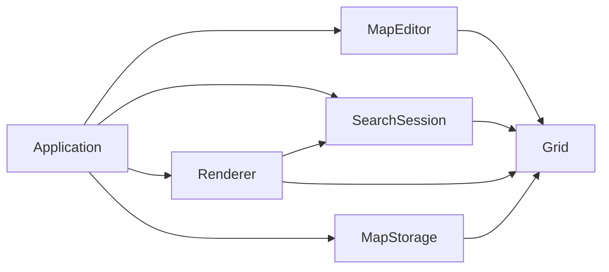

# Архітектура PathExperiment

PathExperiment розділяє модель карти й пошук маршруту від графічного інтерфейсу. Завдяки цьому алгоритми можна тестувати без відкриття вікна та пізніше перенести в Ribterra без залежності від SFML.



## Основні компоненти

| Компонент | Відповідальність |
| --- | --- |
| `Grid` і `Map` | Розміри, типи клітинок, старт, ціль і сусіди в чотирьох напрямках |
| `SearchSession` | Покрокове виконання Dijkstra або A*, стан вузлів і події поточного кроку |
| `SearchResult` | Статус, маршрут, його вартість і кількість опрацьованих клітинок |
| `MapStorage` | Читання та запис версійного формату `.pemap` |
| `MapEditor` | Малювання місцевості й розміщення старту та цілі |
| `Renderer` | Відображення карти, пошуку, підказок і панелей SFML |
| `Application` | Головний цикл, керування режимами, ввід і запуск вимірювань |

Кольори та геометрія клітинок належать графічному шару. Прохідність, вартість входу й координати належать моделі.

## Модель пошуку

Кожен виклик `SearchSession::step()` вилучає наступну актуальну клітинку з черги, позначає її опрацьованою та перевіряє її сусідів. Крок повертає:

- поточну клітинку;
- вдалі відкриття та покращення;
- відхилені стіни, закриті клітинки й переходи без покращення;
- оновлений ланцюжок батьків до поточної клітинки.

Графічний режим відтворює ці події поступово. Режим вимірювання використовує ту саму модель пошуку без малювання і штучних затримок.

Dijkstra ставить у пріоритет накопичену вартість `g`. A* використовує `f = g + h`, де `h` — мангеттенська відстань до цілі. Мінімальна вартість входу дорівнює 1, тому ця евристика не завищує залишкову вартість. Стабільний порядок додавання до черги робить повторні запуски детермінованими.

Вартість маршруту складається з вартостей клітинок, у які він входить. Стартова клітинка не додає вартості. Маршрут у `SearchResult::path` містить і старт, і ціль, тому кількість кроків дорівнює `path.size() - 1`.

## Формат карти

`.pemap` — простий текстовий формат із явною версією:

```text
PATHEXPERIMENT 1
40 25
2 12 37 12
........................................
...
```

Після заголовка йдуть ширина та висота, координати `start_x start_y goal_x goal_y`, а потім рівно один рядок на кожний ряд карти. Координати починаються з нуля.

| Символ | Місцевість | Вартість входу |
| --- | --- | ---: |
| `r` | дорога | 1 |
| `.` | звичайна | 2 |
| `~` | болото | 5 |
| `#` | стіна | непрохідна |

Старт і ціль зберігаються окремо, а клітинки під ними мають залишатися прохідними.

## Повторне використання в Ribterra

Для інтеграції потрібні тільки модулі `Grid` і `Search`; вони не включають заголовки SFML. Ribterra може або використовувати ці типи напряму, або додати адаптер між власною картою та `pathx::Grid`.

Практична послідовність інтеграції:

1. Перетворити прохідність і вартість клітинок Ribterra на `Terrain` або узагальнити джерело вартостей.
2. Виконувати `SearchSession::step()` у симуляції чи викликати `solve()` для повного пошуку.
3. Перетворити `SearchResult::path` на світові координати юніта.

Ця інтеграція не потребує змін у поточному репозиторії Ribterra. PathExperiment залишається окремим стендом для перевірки правил руху й алгоритмів.
