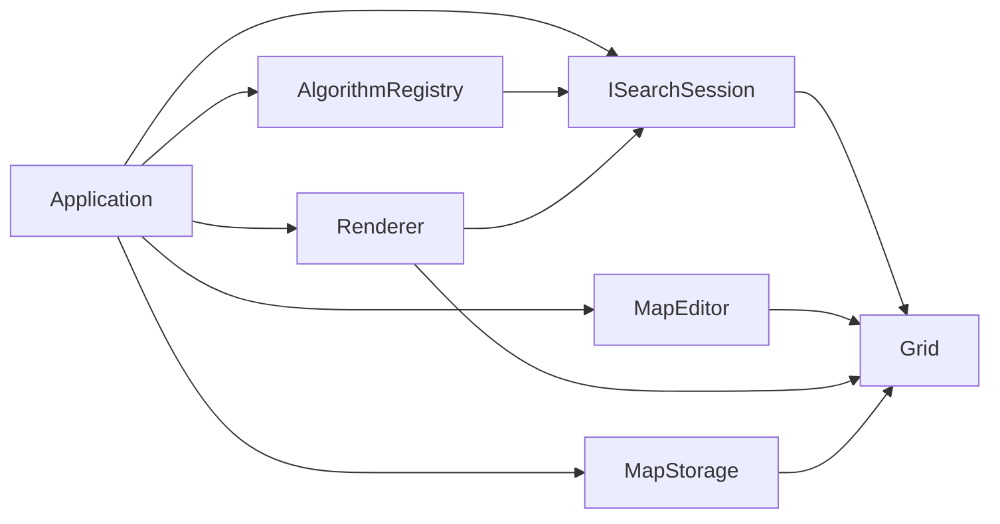

# PathExperiment architecture

PathExperiment keeps the grid model, search sessions, algorithm registry, benchmarking, and map storage independent of SFML. The desktop layer translates input into model changes and renders immutable search data. This boundary makes correctness tests possible without a window and leaves a clean route toward reuse in Ribterra.

## Dependency direction

Dependencies point from the desktop application toward the core. Core headers do not include SFML. Colors, cell geometry, typography, hit testing, and animation timing remain presentation concerns; passability, entry cost, coordinates, node state, and path results remain model concerns.

## Source layout and responsibilities

| Area | Responsibility |
| --- | --- |
| `Grid.hpp` / `Grid.cpp` | terrain, dimensions, bounds, indexes, points, and deterministic four-neighbor generation |
| `Search.hpp` / `Search.cpp` | session contract, built-in session, node state, step events, reconstruction, solve, and benchmark helpers |
| `AlgorithmRegistry.hpp` / `src/core/AlgorithmRegistry.cpp` | descriptor API, validation, and the four default descriptors |
| `src/algorithms/CustomAlgorithms.cpp` | user extension hook |
| `MapStorage.hpp` / `MapStorage.cpp` | strict `.pemap` parsing and non-overwriting saves |
| `Application.*` | main loop, editing, shortcuts, selection, pacing, file actions, and capture modes |
| `Renderer.cpp` / `Theme.hpp` | workbench layout, batched grid drawing, inspector, legend, and hit testing |
| `tests/core_tests.cpp` | headless behavioral, oracle, storage, benchmark, and registry tests |

`pathx_core` is the reusable build target. `PathExperiment` links that target with SFML Graphics.

## Grid model

`Grid` stores a rectangular row-major array of `Terrain`. Public `Point` coordinates are converted to indexes only after bounds validation. Supported maps range from 1 × 1 to 512 × 512; the default `Map` is 120 × 80. Legacy examples are 40 × 25.

The graph represented by a map is $G=(V,E)$: passable cells are vertices, and orthogonal passable neighbors define edges. Every edge cost is the entry cost of its destination:

| Terrain | Entry cost |
| --- | ---: |
| `Road` | 1 |
| `Plain` | 2 |
| `Swamp` | 5 |
| `Wall` | impassable |

For path $p=(v_0,\ldots,v_k)$, `SearchResult::cost` is $\sum_{i=1}^{k}w(v_i)$. The starting cell contributes zero. `SearchResult::path` includes both endpoints, so `steps()` is `path.size() - 1` for a non-empty path. When start equals goal, the result is one point, zero steps, and zero cost.

## Search session contract

The renderer and application depend on `ISearchSession`, not on a concrete algorithm. A session exposes:

- `step()` — expand at most one live cell and return its neighbor evaluations;
- `map()` — the isolated map snapshot used by this run;
- `nodes()` — displayable data for every grid cell;
- `lastStep()` — the current cell and transition outcomes;
- `result()` — status, final path, cost, and expanded count;
- `currentPath()` — the tentative parent chain for explanation.

`NodeData` carries `g`, `h`, `depth`, generic `priority`, parent index, and `Unseen`, `Open`, or `Closed` state. `SearchStep` reports `Discovered`, `Improved`, `Blocked`, `Closed`, and `NoImprovement` outcomes. The API contains enough information for visualization without giving the renderer ownership of algorithm state.

The built-in `SearchSession` copies its `Map` at construction. Editing the application map later cannot mutate an active or measured session.

## One step and frontier invariants

A normal `step()` follows this sequence:

1. Pop queue entries until a live entry matching the current node data is found.
2. Mark that node closed and increment the expanded count.
3. If it is the goal, reconstruct parent links and finish.
4. Inspect deterministic orthogonal neighbors.
5. Classify walls and closed nodes without relaxing them.
6. Compute the candidate value and update a discovered or improved node.
7. Push an entry carrying algorithm-specific priority and insertion order.
8. If the frontier empties, report `NoPath`.

Improvement pushes a new entry instead of mutating the heap. Older entries are skipped when their recorded values no longer match. This lazy strategy avoids decrease-key. A monotonically increasing `order` provides stable FIFO tie-breaking for equal priorities.

Closed nodes are not reopened. For Dijkstra this is safe with positive costs. For A*, Manhattan distance is consistent because an orthogonal move changes it by at most 1 and every entry costs at least 1:

$$
h(n)\le 1+h(n')\le w(n')+h(n').
$$

## Built-in policies

The built-in session shares storage and event behavior while changing frontier priority and improvement rules.

| Algorithm | Priority | Result guarantee |
| --- | --- | --- |
| Dijkstra | `g` | lowest weighted cost |
| A* | `g + h` | lowest weighted cost with consistent Manhattan `h` |
| Breadth-first | `depth` | fewest steps; weighted cost may be higher |
| Greedy best-first | `h` | no lowest-cost guarantee |

For A* and greedy search, $h(n)=|x_n-x_G|+|y_n-y_G|$.

BFS is implemented through the shared priority queue, ordered by depth and stable insertion order. A classical dedicated FIFO implementation is $O(V+E)$; this shared heap implementation is $O((V+E)\log V)$. Dijkstra, A*, and greedy best-first use the same asymptotic heap bound. Node storage is $O(V)$, while lazy entries can occupy $O(E)$.

## Algorithm registry

`AlgorithmRegistry` stores ordered `AlgorithmDescriptor` values. Each descriptor provides a stable ID, display name, description, priority formula, lowest-cost guarantee flag, and a factory returning `std::unique_ptr<ISearchSession>`.

The registry is the single source for the dropdown, explanatory copy, `Tab` order, and benchmark rows. `makeDefaultRegistry()` adds the four built-ins and then invokes `registerCustomAlgorithms(registry)`. A user-defined descriptor registered there appears in selection and benchmarking after rebuilding; there is no runtime DLL discovery or CLI scripting layer.

The detailed implementation contract belongs in [Adding algorithms](ADDING_ALGORITHMS.md).

## Application state and interaction

`Application` owns the editable map, selected descriptor, current session, comparison rows, editor tool, pointer state, speed, selected sample, and status message. Any map edit clears the current session and benchmark data so stale results cannot be presented as belonging to new terrain.

Endpoint tools accept any cell. If the target is a wall, editing converts it to plain before assigning the endpoint. Start and goal may overlap. `Shift` + left-click places start and `Ctrl` + left-click places goal directly.

The logical surface is 1280 × 820. Resized windows use a letterboxed view, and mouse coordinates are transformed through the same view to preserve hit testing. The default 120 × 80 grid is drawn at approximately 8 px per cell. Smaller loaded maps use their own dimensions.

Normal visual playback permits at most one expansion per rendered frame and ranges from 1 to 60 expansions per second. `Finish` executes the remaining session without animation. Benchmarking also runs without drawing or artificial delay.

## Rendering

The renderer presents a light neutral workbench with compact top tools, a dominant white canvas, and one right inspector. It uses bundled Noto Sans, ordinary text rows, fine dividers, and functional colors:

- blue frontier and pale-blue explored cells;
- amber current cell and tentative path;
- green final route;
- muted red rejected transitions;
- text `S` and `G` in addition to color.

The inspector reads node and result data through the session interface. It does not calculate search decisions. Rectangle and line geometry is batched to keep a 9,600-cell default grid responsive.

## Benchmark boundary

`benchmark()` runs one untimed warm-up followed by the requested number of independent sessions, 31 by default. Each timed sample includes session construction, search, and route reconstruction. It excludes SFML rendering, animation pacing, and screenshot encoding. Samples are sorted and the median is reported.

The application benchmarks every registry descriptor against the same map snapshot. Results from different algorithms may validly differ in steps, cost, and expanded cells; only descriptors marked as lowest-cost algorithms promise the minimum weighted cost.

## Map storage

`.pemap` begins with `PATHEXPERIMENT 1`, dimensions, and zero-based endpoint coordinates, followed by exactly one terrain row per map row. The parser rejects unsupported versions, dimensions outside the supported range, invalid symbols, missing or extra content, out-of-bounds endpoints, and wall endpoints before replacing the current application map.

`saveMap()` refuses to overwrite an existing path. The application generates timestamped names. Windows uses a native open-file picker; other systems load the newest saved `.pemap`.

## Native capture modes

`--smoke-test DIR` drives native input and state transitions, records diagnostic images, and writes a report. `--record-demo DIR` records native search and comparison frames. Demo capture uses an adaptive stride on large maps to bound GIF size; normal interactive playback still renders every expansion separately.

These modes create new output. They do not replace the headless core suite, and a screenshot alone is not evidence that all behaviors passed.

## Reuse in Ribterra

A future integration needs the core model and a small adapter, not SFML:

1. Translate Ribterra passability and movement cost into a grid-like source.
2. Create a registered session or call `solve()` for the selected policy.
3. Convert returned grid points into Ribterra world coordinates.
4. Decide when to invalidate or recompute a route as the game world changes.

PathExperiment remains an isolated experiment repository. This architecture does not modify the current Ribterra repository and does not claim that game integration has shipped.
